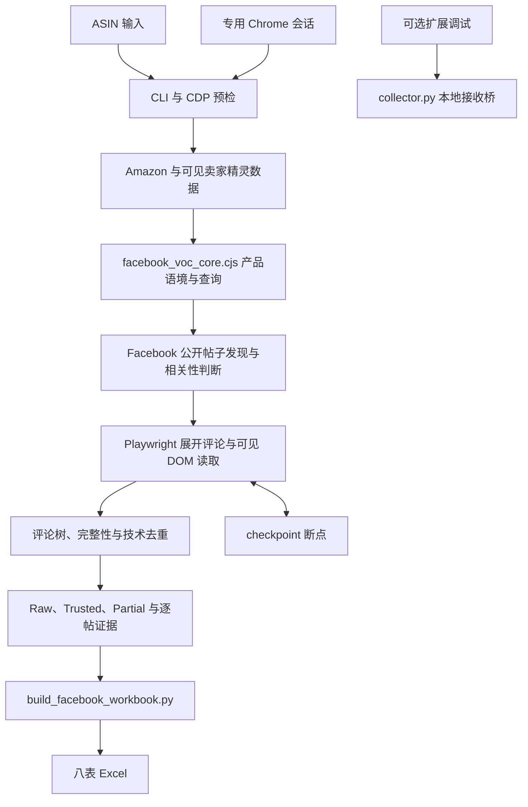

# 详细说明

> 本文件是 README 的完整版：README 已改为适合扫读的简版，迁移前 README 里的环境要求、安装配置、完整命令、数据边界、项目文件清单、开发状态与历史记录等细节，都完整保存在这里，内容与迁移前 README 一致，未删减任何信息。
>
> 迁移前 README 标题：Facebook VOC 评论采集器。以下按原章节顺序完整保留迁移前 README 原文，原文中的相对链接路径以仓库根目录为基准，未做改写；原文中的 mermaid 架构图一并保留。

# Facebook VOC 评论采集器

## 一眼看懂

- 这是什么：按商品编号找 Facebook 公开帖子并采评论。
- 什么时候用：要理清公开主页帖子和视频里的回复关系时。
- 给它什么：商品编号或编号清单，和一个已登录的浏览器。
- 它给你什么：八张表的 Excel，含评论、回复树和帖子审核。

## 项目简介

`facebook-voc-collector` 是由 Amazon ASIN 驱动的 Facebook 公开评论采集工具，也可作为 Codex Skill 使用。程序从商品和可见卖家精灵数据建立产品语境，生成查询，发现公开 Page 帖子、视频和 Reels，再读取可见评论与回复，输出原始数据、审核记录和 Excel。

正式入口是 `scripts/facebook_playwright_collector.cjs`，通过 Playwright 连接专用 Chrome Profile 的 CDP 会话。`extension/` 和 Python 本地接收桥保留为可见 DOM 调试工具，不是正式自动采集的必需步骤。

## 核心功能

- 支持单 ASIN、逗号分隔 ASIN 组和 ASIN 文件，合并去重后按当前产品证据生成七类查询。
- 首轮使用 Amazon 与可见卖家精灵证据；后续发现轮次从已取得的帖子和真实评论中扩展语言，并保留查询来源。
- 对候选帖子做产品相关性判断，进入合格帖子后选择可见的全部评论排序、展开评论和回复，并逐次保存断点。
- 保留原始可见文本与清洗正文，单独标记纯时间/UI 记录；真实评论仅按稳定评论 ID 技术去重，没有稳定 ID 的评论保留并标记不确定性。
- 保存评论树、直接父评论、回复深度、剩余展开控件和动作记录，以 PASS/PARTIAL/BLOCKED 区分完整性。
- 将非 UI 的 PASS 评论写入 Trusted，将非 UI 的 PARTIAL 评论写入候选层；已读原始记录仍保留在 Raw。
- 生成 JSONL、CSV、查询与页面映射、manifest、checkpoint、逐帖证据以及八表 Excel，支持断点续跑和不完整帖子重审。

| 工作表 | 内容 |
| --- | --- |
| Raw_Comments | 原始已读记录及保留的 UI 证据 |
| Trusted_Comments | 非 UI 的 PASS 评论 |
| Partial_Candidates | 非 UI 的 PARTIAL 评论 |
| Conversation_Map | 商品与社区语言语境 |
| Query_Performance | 查询来源、执行及发现情况 |
| Post_Audit | 帖子完整性与评论树审核 |
| Run_Summary | 采集、重复、回复及可信评论数量 |
| Quality_Gate | 数量、父子关系、子集分流与 UI 污染检查 |

## 技术栈

| 用途 | 技术与仓库约束 |
| --- | --- |
| 自动采集与评论树 | Node.js 20+，Playwright `>=1.55.0 <2` |
| 浏览器会话 | Google Chrome、CDP，默认本机端口 `9222` |
| 工作簿与调试桥 | Python 3.10–3.13，openpyxl `>=3.1,<4`；`.python-version` 为 `3.12.13` |
| 专用 Chrome 启动 | Windows PowerShell 脚本 |
| 可选调试界面 | Chrome 扩展、HTML 与 JavaScript |
| 测试 | unittest、Node test runner、GitHub Actions |

正式自动启动流程以 Windows 为主。CI 在 Windows、macOS 和 Ubuntu 上运行离线测试，不能据此推断所有平台的在线浏览器流程均已验收。

## 快速开始

### 安装

以下命令从 Windows PowerShell 执行：

```powershell
git clone https://github.com/fubo-ops/facebook-voc-collector.git
cd facebook-voc-collector
python -m venv .venv
.venv\Scripts\Activate.ps1
python -m pip install -r requirements.txt
npm ci
```

需要 Node.js 20+、Python 3.10–3.13 和 Google Chrome。macOS/Linux 可激活 `.venv/bin/activate` 运行离线测试；仓库中的自动 CDP 启动器调用 `powershell.exe`，不提供对应平台的自动启动实现。

### 环境准备与预检

```powershell
.\scripts\start_facebook_cdp.ps1
node scripts/facebook_playwright_collector.cjs preflight --asin ASIN --session-mode cdp --headless 0
```

将 `ASIN` 替换为实际 10 位商品标识。启动器使用专用浏览器资料目录；首次登录由使用者在浏览器内完成。预检和采集只读取当前会话可见的内容，不自动处理登录或验证码。

### 采集、批量与续跑

```powershell
node scripts/facebook_playwright_collector.cjs collect --asin ASIN --target-comments 300 --target-posts 30 --max-comments-per-post 0 --max-discovery-rounds 5 --session-mode cdp --headless 0
node scripts/facebook_playwright_collector.cjs collect --asins ASIN_A,ASIN_B --session-mode cdp
node scripts/facebook_playwright_collector.cjs collect --asin-file asins.csv --session-mode cdp
```

`--max-comments-per-post 0` 不设置单帖条数上限，但动作、超时和访问限制仍可能使帖子标为 PARTIAL。使用已有输出目录中的实际断点路径恢复：

```powershell
node scripts/facebook_playwright_collector.cjs collect --asin ASIN --resume "Facebook评论采集/ASIN/checkpoint.json" --retry-partial --force-reaudit-partial --session-mode cdp
```

默认输出根目录来自 `FACEBOOK_COLLECTION_ROOT` 环境变量；未设置时使用当前目录的 `Facebook评论采集/`，子目录由输入 ASIN 拼接。可用 `--out-dir outputs/run-001` 指定目录。

输出包括 `raw_comments.jsonl`、`trusted_comments.jsonl`、`partial_candidates.jsonl`、`raw_comments.csv`、`conversation_map.json`、`query_plan.json`、`page_map.json`、`manifest.json`、`checkpoint.json`、`{ASIN}_Facebook评论.xlsx` 和 `evidence/`。评论、店铺资料、浏览器 Profile、断点与生成文件均不提交到 Git。

## 项目结构

以下完整结构对应 `git ls-files`，不含运行产物：

```text
facebook-voc-collector/
├── .github/
│   └── workflows/
│       └── test.yml
├── .gitignore
├── .python-version
├── LICENSE
├── README.md
├── SKILL.md
├── agents/
│   └── openai.yaml
├── extension/
│   ├── capture.js
│   ├── manifest.json
│   ├── popup.html
│   └── popup.js
├── package-lock.json
├── package.json
├── pyproject.toml
├── references/
│   ├── collection-guide.md
│   └── raw-record-schema.md
├── requirements.txt
├── scripts/
│   ├── __init__.py
│   ├── build_facebook_workbook.py
│   ├── collector.py
│   ├── facebook_playwright_collector.cjs
│   ├── facebook_visible_capture.js
│   ├── facebook_voc_core.cjs
│   ├── quick_validate.py
│   └── start_facebook_cdp.ps1
└── tests/
    ├── test_collector.py
    ├── test_facebook_core.cjs
    ├── test_popup.cjs
    ├── test_repository_distribution.py
    └── test_workbook.py
```

根目录没有需要迁入 `docs/` 的过程文档，也没有已跟踪的运行产物；Skill 入口、资源和 references 保留原路径。

## 架构图



## 当前状态与开发计划

已有自动查询、公开帖子发现、评论树展开、UI 记录区分、完整性分流、断点重审和八表导出实现。离线测试覆盖评论去重、父子关系、查询、弹窗调试、工作簿与分发契约，CI 配置了三个操作系统与 Python 3.10/3.13。

已准备依赖的环境可运行：

```bash
python -B -m unittest discover -s tests -p "test_*.py" -v
npm test
npm run check
python -B scripts/quick_validate.py .
```

`package.json` 和正式 Node CLI 标为 `2.1.0`，`pyproject.toml` 仍为 `1.0.0`，版本元数据待统一。在线效果受 Facebook 页面、登录和访问限制影响；PASS 仅表示当前可见评论树满足仓库完整性规则，不代表平台全部评论。当前真实业务环境验收记录与后续开发计划待补充。

## 文档

- [Skill 入口](SKILL.md)
- [采集、发现、续跑与停止规则](references/collection-guide.md)
- [评论字段、父子关系与审核契约](references/raw-record-schema.md)
- [Windows CDP 启动器](scripts/start_facebook_cdp.ps1)
- [工作簿构建入口](scripts/build_facebook_workbook.py)
- [CI 配置](.github/workflows/test.yml)

## 许可证

采用 [MIT License](LICENSE)。
